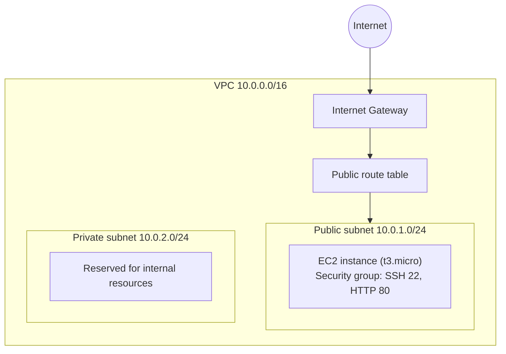

# Terraform AWS Infrastructure

Terraform configuration that provisions a small AWS network and a single EC2 instance, with remote state stored in Amazon S3.

## Architecture



## What it creates

| Resource | Purpose |
| --- | --- |
| VPC | Isolated network with DNS support and DNS hostnames enabled |
| Internet gateway | Gives the VPC a route to the internet |
| Public subnet | Hosts the EC2 instance and assigns public IPs on launch |
| Private subnet | Has no internet route; reserved for internal resources |
| Route table and association | Sends public subnet traffic through the internet gateway |
| Security group | Allows inbound SSH (22) and HTTP (80), and all outbound traffic |
| EC2 instance | A `t3.micro` instance launched in the public subnet |

All resources are tagged with a name prefix taken from `project_name`.

## Project structure

```
.
├── main.tf               # Provider, S3 backend and all resources
├── variables.tf          # Input variables with defaults
├── outputs.tf            # Values printed after apply
├── terraform.tfvars      # Variable values for this deployment
└── backend.hcl.example   # Template for the state bucket setting
```

## Prerequisites

- [Terraform](https://developer.hashicorp.com/terraform/install) 1.x
- An AWS account, with credentials configured (for example through `aws configure`)
- An S3 bucket to hold the Terraform state

## Usage

1. Clone the repository:

   ```bash
   git clone https://github.com/Ca15y/terraform-aws-infrastructure.git
   cd terraform-aws-infrastructure
   ```

2. Create your backend configuration and set the name of an S3 bucket you own:

   ```bash
   cp backend.hcl.example backend.hcl
   ```

3. Initialise, review and apply:

   ```bash
   terraform init -backend-config=backend.hcl
   terraform plan
   terraform apply
   ```

4. Remove everything when you are finished, to avoid charges:

   ```bash
   terraform destroy
   ```

## Variables

| Name | Description | Default |
| --- | --- | --- |
| `aws_region` | AWS region to deploy resources | `us-east-1` |
| `project_name` | Name prefix for all resources | `devops-proj-2` |
| `vpc_cidr` | CIDR block for the VPC | `10.0.0.0/16` |
| `public_subnet_cidr` | CIDR block for the public subnet | `10.0.1.0/24` |
| `private_subnet_cidr` | CIDR block for the private subnet | `10.0.2.0/24` |
| `instance_type` | EC2 instance type | `t3.micro` |

## Outputs

| Name | Description |
| --- | --- |
| `vpc_id` | ID of the VPC |
| `public_subnet_id` | ID of the public subnet |
| `private_subnet_id` | ID of the private subnet |
| `ec2_public_ip` | Public IP of the EC2 instance |
| `security_group_id` | ID of the EC2 security group |

## Remote state

State is stored in an S3 bucket through the `backend "s3"` block, so it is not kept on a local machine and can be shared between collaborators. The bucket name is passed in at `terraform init` from a local `backend.hcl` file, which is ignored by git.

## Known limitations and next steps

This is a learning project, and these are the improvements I would make next:

- **Restrict SSH access.** Port 22 is currently open to `0.0.0.0/0`. It should be limited to a known IP range, or replaced with AWS Systems Manager Session Manager.
- **Add state locking.** Enable locking on the S3 backend so two people cannot apply at the same time.
- **Look up the AMI dynamically.** The AMI ID is hardcoded and only valid in `us-east-1`. An `aws_ami` data source would make the configuration work in any region.
- **Attach a key pair.** The instance is launched without one, so it cannot be reached over SSH yet.
- **Give the private subnet outbound access** through a NAT gateway, and spread subnets across more than one availability zone.
- **Split the configuration into modules** (network, compute) so it can be reused.
